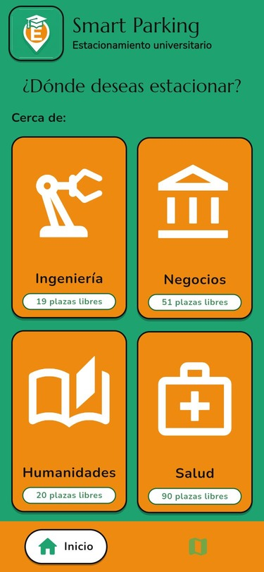
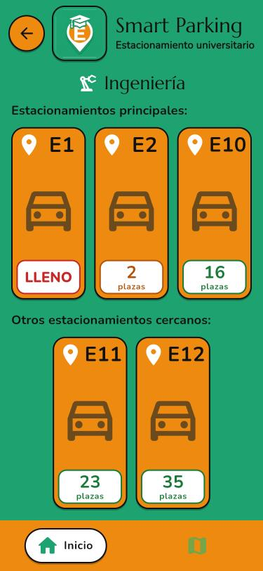
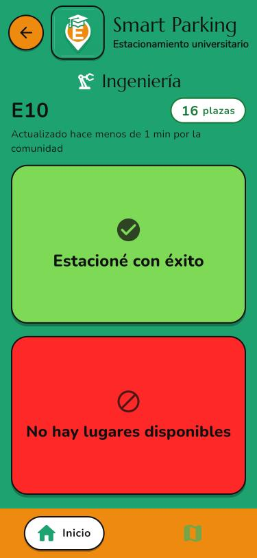
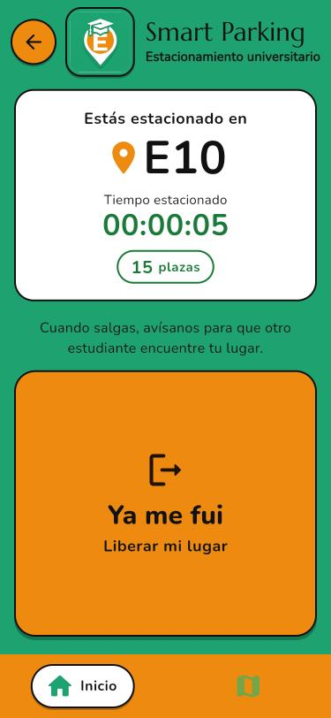
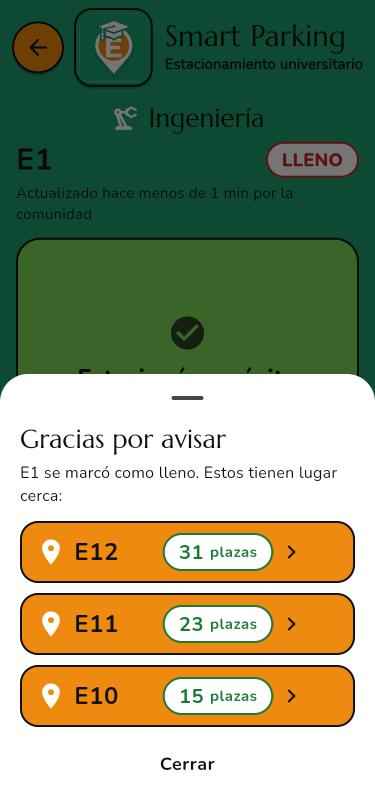
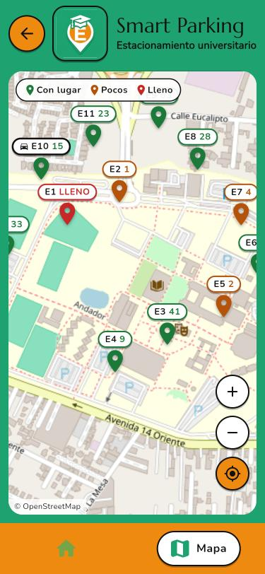
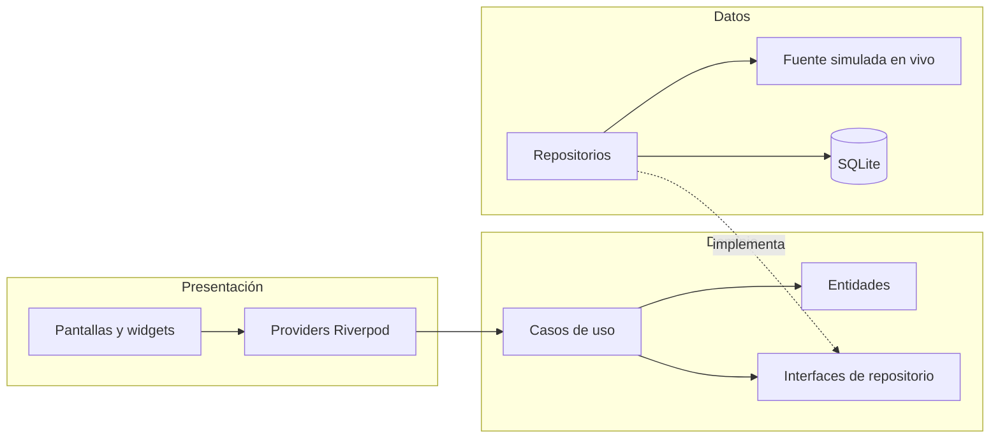

<div align="center">


# Smart Parking UDLAP

**Disponibilidad de estacionamiento en tiempo real, construida por la propia comunidad universitaria.**

[](https://flutter.dev)
[](https://dart.dev)
[](https://riverpod.dev)
[](#ejecutar-el-proyecto)
[](LICENSE)

[**Ver demo en vivo**](https://sparkly-chaja-5f8bec.netlify.app) &nbsp;|&nbsp;
[Capturas](#capturas) &nbsp;|&nbsp;
[Arquitectura](#arquitectura) &nbsp;|&nbsp;
[Diseño centrado en el usuario](#diseño-centrado-en-el-usuario)

</div>

---

## Descripción

Encontrar lugar en el campus en hora pico implica dar vueltas entre estacionamientos sin saber cuál tiene espacio. **Smart Parking** resuelve ese problema con *crowdsourcing*: cada estudiante que se estaciona, que encuentra un estacionamiento lleno o que se retira lo reporta con un solo toque, y la disponibilidad se actualiza en vivo para todos.

El proyecto fue desarrollado para la materia **Interacción Humano-Computadora** en la Universidad de las Américas Puebla (UDLAP). Por eso el énfasis está en la experiencia de uso: interacciones de un toque, retroalimentación inmediata y una interfaz legible a simple vista, pensada para usarse con prisa o caminando.

> **Nota:** esta versión es un prototipo funcional. Los estacionamientos, su capacidad y su ubicación son aproximados, y el tráfico de otros usuarios se simula para demostrar las actualizaciones en tiempo real.

## Funcionalidades

- **Búsqueda por zona del campus.** Ingeniería, Negocios, Humanidades y Salud, cada una con el total de plazas libres visible desde la pantalla de inicio.
- **Disponibilidad en vivo.** Cada estacionamiento muestra sus plazas con código de color (disponible, pocas, lleno) y se actualiza sin recargar.
- **Reporte de un toque.** Dos botones de gran tamaño: "Estacioné con éxito" y "No hay lugares disponibles".
- **Alternativas inteligentes.** Al reportar un estacionamiento lleno, la app sugiere de inmediato los tres cercanos con más lugar.
- **Ciclo completo de estancia.** Cronómetro del tiempo estacionado y botón "Ya me fui" que libera el lugar para otro estudiante.
- **Mapa del campus.** Mapa interactivo (OpenStreetMap) con marcadores de color por disponibilidad.
- **Historial persistente.** Los reportes y la estancia activa se guardan localmente con SQLite.
- **Aplicación web instalable (PWA).** Se puede agregar a la pantalla de inicio del teléfono y abrir como una app nativa.

## Capturas

<table>
  <tr>
    <td align="center"><br /><sub><b>Inicio</b> - zonas del campus</sub></td>
    <td align="center"><br /><sub><b>Zona</b> - plazas en vivo</sub></td>
    <td align="center"><br /><sub><b>Reporte</b> - acción de un toque</sub></td>
  </tr>
  <tr>
    <td align="center"><br /><sub><b>Estancia</b> - cronómetro y salida</sub></td>
    <td align="center"><br /><sub><b>Alternativas</b> - si está lleno</sub></td>
    <td align="center"><br /><sub><b>Mapa</b> - vista general</sub></td>
  </tr>
</table>

Los bocetos originales de baja fidelidad se encuentran en [`assets/mockups`](assets/mockups).

## Diseño centrado en el usuario

Cada decisión de interfaz responde a un principio de IHC:

| Principio | Aplicación en la app |
|---|---|
| **Ley de Fitts** | Los botones de reporte ocupan casi toda la pantalla y se pueden tocar sin precisión, incluso caminando. |
| **Retroalimentación inmediata** | Cada toque produce una animación de rebote, una onda de luz desde el punto de contacto, un sonido y una vibración en menos de 100 ms. |
| **Visibilidad del estado del sistema** | Contadores animados en vivo, antigüedad del dato ("actualizado hace 1 min") y un aviso permanente de la estancia activa. |
| **Prevención de errores** | Durante el envío los botones se desactivan para evitar reportes dobles; al estacionarse en otro lugar se libera automáticamente el anterior. |
| **Reconocimiento antes que recuerdo** | Zonas identificadas por icono y nombre; código de color consistente (verde, naranja, rojo) en tarjetas y mapa. |
| **Continuidad espacial** | Transiciones *Hero*: el icono y el nombre de la zona viajan entre pantallas para que el usuario no pierda el contexto. |
| **Cierre del ciclo** | "Ya me fui" completa la tarea y devuelve el lugar a la comunidad, en lugar de dejar datos obsoletos. |
| **Accesibilidad** | Tipografía grande y en negritas, alto contraste y etiquetas semánticas para lectores de pantalla (TalkBack y VoiceOver). |

## Arquitectura

El proyecto sigue **Clean Architecture** en tres capas. Las dependencias apuntan siempre hacia el dominio, de modo que la fuente de datos simulada puede sustituirse por un backend real sin modificar la interfaz.



```
lib/
├── core/            Tema, rutas, sonido y vibración, widgets reutilizables
├── domain/          Entidades, contratos de repositorio y casos de uso (Dart puro)
├── data/            Modelos, SQLite, fuente simulada e implementaciones
└── presentation/    Providers de Riverpod y pantallas
```

**Decisiones técnicas destacadas**

- **Riverpod 3** para el estado: `StreamProvider` para la disponibilidad en vivo, `AsyncNotifier` para la estancia activa y `Provider.family` para datos por estacionamiento.
- **Inyección de dependencias** mediante providers: en Android e iOS se usa SQLite y en la web un repositorio en memoria, sin cambios en la interfaz.
- **Audio de baja latencia**: `AudioPool` en móvil y la Web Audio API en navegador, reproducido de forma síncrona dentro del gesto para cumplir las políticas de iOS.
- **Rendimiento en web**: animaciones sin capas de opacidad, sombras sólidas, `RepaintBoundary` en elementos animados, cuadros limitados a 60 fps en pantallas de 120 Hz y WebAssembly cuando el navegador lo permite.

## Tecnologías

| Área | Herramienta |
|---|---|
| Framework | Flutter 3.47, Dart 3.13 |
| Estado | flutter_riverpod 3 |
| Persistencia | sqflite |
| Mapas | flutter_map, latlong2, OpenStreetMap |
| Audio | audioplayers (móvil), Web Audio API (web) |
| Tipografía | Google Fonts (Marcellus, Nunito) |
| Despliegue web | Netlify |

## Ejecutar el proyecto

**Requisitos:** [Flutter](https://docs.flutter.dev/get-started/install) 3.47 o superior y, para móvil, Android Studio (emulador) o Xcode.

```bash
git clone https://github.com/CcsArepa/smart-parking-app.git
cd smart-parking-app
flutter pub get
```

| Objetivo | Comando |
|---|---|
| Android / iOS (emulador o dispositivo) | `flutter run` |
| Navegador | `flutter run -d chrome` |
| Compilación web de producción | `flutter build web --release --wasm` |

## Pruebas

```bash
flutter analyze
flutter test
```

La suite cubre los casos de uso del dominio (reportes y estancias) y los flujos principales de la interfaz, incluidas pruebas de regresión de las transiciones *Hero* al navegar rápidamente entre pantallas.

## Trabajo futuro

- Backend en tiempo real (por ejemplo, Firebase o Supabase) para compartir reportes entre dispositivos.
- Coordenadas y capacidades reales de cada estacionamiento.
- Recordatorio para marcar la salida y opción de deshacer un reporte.
- Reputación de usuarios para dar más peso a reportes confiables.

## Autor

Desarrollado por [**CcsArepa**](https://github.com/CcsArepa) para el curso de Interacción Humano-Computadora, Universidad de las Américas Puebla.

## Licencia

Distribuido bajo la licencia MIT. Consulta [`LICENSE`](LICENSE) para más detalles.
