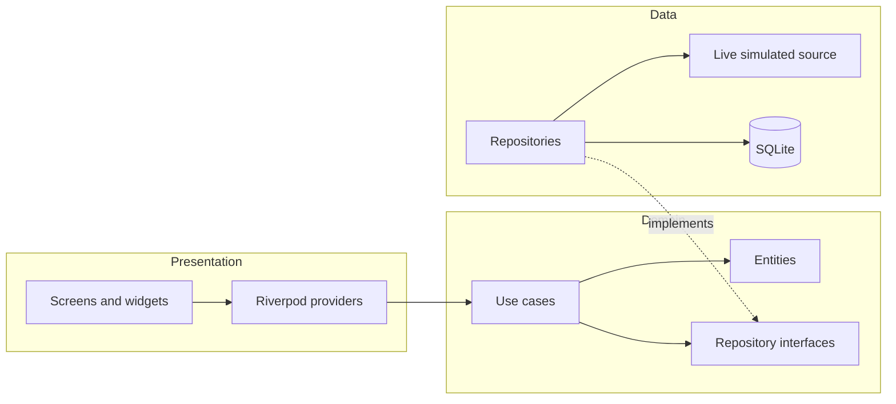

<div align="center">


# Smart Parking UDLAP

**Real-time campus parking availability, powered by the student community.**

[](https://flutter.dev)
[](https://dart.dev)
[](https://riverpod.dev)
[](#getting-started)
[](#testing)
[](LICENSE)

[**Live Demo**](https://sparkly-chaja-5f8bec.netlify.app) &nbsp;|&nbsp;
[Screenshots](#screenshots) &nbsp;|&nbsp;
[Architecture](#architecture) &nbsp;|&nbsp;
[UX Design](#user-centered-design)

</div>

---

## Overview

Finding a parking spot on campus during peak hours means driving in circles between lots with no idea which one has space. **Smart Parking** solves this through crowdsourcing: every student who parks, finds a full lot, or leaves reports it with a single tap, and availability updates live for everyone.

Built for the **Human-Computer Interaction** course at Universidad de las Américas Puebla (UDLAP), the project puts user experience first: one-tap interactions, instant multisensory feedback, and an interface readable at a glance, designed to be used in a hurry or on the move.

The interface is in Spanish, the native language of its target users.

> **Note:** this is a functional prototype. Parking lots, capacities, and locations are approximate, and other users' activity is simulated to demonstrate real-time updates.

## Highlights

- **Clean Architecture** with fully decoupled presentation, domain, and data layers. The simulated data source can be swapped for a real backend without touching the UI.
- **Reactive state management** with Riverpod 3 (`StreamProvider`, `AsyncNotifier`, `Provider.family`) and dependency injection through providers.
- **One codebase, three platforms:** Android, iOS, and an installable Progressive Web App deployed on Netlify.
- **Performance engineering for the web:** WebAssembly when supported, frame pacing for 120 Hz displays, layer-free animations, and isolated repaints.
- **Every design decision is backed by HCI principles** (Fitts's Law, immediate feedback, error prevention, system status visibility).
- **Tested:** domain use cases, end-to-end UI flows, and regression tests for navigation edge cases.

## Features

- **Browse by campus zone.** Engineering, Business, Humanities, and Health, each showing its total free spots on the home screen.
- **Live availability.** Every lot shows its free spots with color coding (available, few left, full) and updates without refreshing.
- **One-tap reporting.** Two oversized buttons: "I parked successfully" and "No spots available".
- **Smart alternatives.** When a lot is reported full, the app instantly suggests the three nearby lots with the most space.
- **Full parking session lifecycle.** A timer tracks how long you have been parked, and an "I'm leaving" button frees the spot for another student.
- **Campus map.** Interactive OpenStreetMap view with availability-colored markers.
- **Persistent history.** Reports and the active session are stored locally with SQLite.
- **Installable PWA.** Add it to the phone's home screen and open it like a native app.

## Screenshots

<table>
  <tr>
    <td align="center"><br /><sub><b>Home</b>: campus zones</sub></td>
    <td align="center"><br /><sub><b>Zone</b>: live spot counts</sub></td>
    <td align="center"><br /><sub><b>Report</b>: one-tap action</sub></td>
  </tr>
  <tr>
    <td align="center"><br /><sub><b>Session</b>: timer and check-out</sub></td>
    <td align="center"><br /><sub><b>Alternatives</b>: when a lot is full</sub></td>
    <td align="center"><br /><sub><b>Map</b>: campus overview</sub></td>
  </tr>
</table>

The original low-fidelity sketches are available in [`assets/mockups`](assets/mockups).

## User-Centered Design

Each interface decision maps to an HCI principle:

| Principle | How it is applied |
|---|---|
| **Fitts's Law** | Report buttons fill most of the screen and can be hit without precision, even while walking. |
| **Immediate feedback** | Every tap triggers a bounce animation, a light ripple from the touch point, a sound, and haptic feedback in under 100 ms. |
| **Visibility of system status** | Animated live counters, data freshness ("updated 1 min ago"), and a persistent banner for the active session. |
| **Error prevention** | Buttons are disabled while sending to avoid duplicate reports; parking elsewhere automatically frees the previous spot. |
| **Recognition over recall** | Zones are identified by icon and name; a consistent color code (green, orange, red) is used across cards and map. |
| **Spatial continuity** | Hero transitions carry the zone icon and name between screens so users never lose context. |
| **Closing the loop** | "I'm leaving" completes the task and returns the spot to the community instead of leaving stale data. |
| **Accessibility** | Large bold typography, high contrast, and semantic labels for screen readers (TalkBack and VoiceOver). |

## Architecture

The project follows **Clean Architecture** in three layers. Dependencies always point toward the domain, so the simulated data source can be replaced by a real backend without changing the interface.



```
lib/
├── core/            Theme, routing, sound and haptics, reusable widgets
├── domain/          Entities, repository contracts, and use cases (pure Dart)
├── data/            Models, SQLite, simulated source, and implementations
└── presentation/    Riverpod providers and screens
```

**Key technical decisions**

- **Riverpod 3** for state: `StreamProvider` for live availability, `AsyncNotifier` for the active session, and `Provider.family` for per-lot data.
- **Dependency injection** through providers: SQLite on Android and iOS, an in-memory repository on the web, with no UI changes.
- **Low-latency audio**: `AudioPool` on mobile and the Web Audio API in the browser, played synchronously within the gesture to comply with iOS autoplay policies.
- **Web performance**: no opacity layers in animations, solid shadows, `RepaintBoundary` on animated elements, frames capped at 60 fps on 120 Hz displays, and WebAssembly when the browser supports it.

## Tech Stack

| Area | Tools |
|---|---|
| Framework | Flutter 3.47, Dart 3.13 |
| State management | flutter_riverpod 3 |
| Persistence | sqflite |
| Maps | flutter_map, latlong2, OpenStreetMap |
| Audio | audioplayers (mobile), Web Audio API (web) |
| Typography | Google Fonts (Marcellus, Nunito) |
| Web deployment | Netlify |

## Getting Started

**Requirements:** [Flutter](https://docs.flutter.dev/get-started/install) 3.47 or later and, for mobile, Android Studio (emulator) or Xcode.

```bash
git clone https://github.com/CcsArepa/smart-parking-app.git
cd smart-parking-app
flutter pub get
```

| Target | Command |
|---|---|
| Android / iOS (emulator or device) | `flutter run` |
| Browser | `flutter run -d chrome` |
| Production web build | `flutter build web --release --wasm` |

## Testing

```bash
flutter analyze
flutter test
```

The suite covers domain use cases (reports and parking sessions) and the main UI flows, including regression tests for Hero transitions during rapid navigation.

## Roadmap

- Real-time backend (e.g., Firebase or Supabase) to share reports across devices.
- Real coordinates and capacities for each parking lot.
- Check-out reminders and an undo option for reports.
- User reputation to give more weight to reliable reports.

## Author

Developed by [**CcsArepa**](https://github.com/CcsArepa) for the Human-Computer Interaction course at Universidad de las Américas Puebla.

## License

Distributed under the MIT License. See [`LICENSE`](LICENSE) for details.
